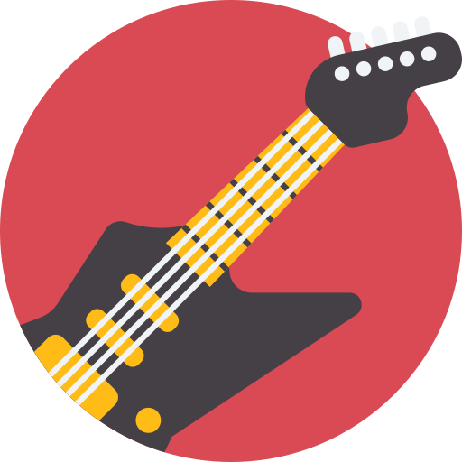

<p align="center">
  
</p>

# Roadie 🎸

A self-hosted Discord bot that watches live-music listings and posts upcoming shows matching your server's genres into a channel you choose.

## Features

- **New-show alerts**: rich embeds posted once per show, deduplicated across sources.
- **Artist watchlist**: get alerts when specific artists announce dates (Bandsintown, optional).
- **`/shows`**: on-demand search near your server's configured location.
- **Weekly digest**: a summary of the next two weeks on the weekday you pick.

## Data sources

| Source                   | Status                     | Notes                                                                                                   |
| ------------------------ | -------------------------- | ------------------------------------------------------------------------------------------------------- |
| Ticketmaster Discovery   | Supported                  | Genre + location search. Free API key. This is the main source.                                         |
| Bandsintown              | Supported (watchlist only) | Public API is artist-keyed only and intended for artists. See [setup](#3-bandsintown-api-key-optional). |
| Songkick / FestivalGuide | Planned, optional scrapers | No open API. Disabled by default; check each site's terms of service and robots.txt before enabling.    |

## Self-hosting guide

You run your own copy of the bot with your own credentials, so there is no shared server and no one else holds your token. You need four values:

| Value                  | Required    | Where to get it                                |
| ---------------------- | ----------- | ---------------------------------------------- |
| `DISCORD_CLIENT_ID`    | yes         | [Discord](#1-discord-client-id-and-bot-token)  |
| `DISCORD_TOKEN`        | yes         | [Discord](#1-discord-client-id-and-bot-token)  |
| `TICKETMASTER_API_KEY` | recommended | [Ticketmaster](#2-ticketmaster-api-key)        |
| `BANDSINTOWN_APP_ID`   | optional    | [Bandsintown](#3-bandsintown-api-key-optional) |

Without a Ticketmaster key the bot starts but has nothing to search, so `/shows` and genre alerts return no results.

### 1. Discord client ID and bot token

1. Go to the [Discord Developer Portal](https://discord.com/developers/applications) and click **New Application**. Name it (e.g. "Roadie") and accept the terms.
2. On **General Information**, copy the **Application ID**. This is your `DISCORD_CLIENT_ID`.
3. Open the **Bot** tab and click **Reset Token**, then copy the token. This is your `DISCORD_TOKEN`. Discord shows it only once; if you lose it, reset it again.
   - Treat the token like a password. Anyone with it can control your bot. If it leaks, reset it immediately.
   - You do **not** need any privileged gateway intents (Presence, Server Members, Message Content). Leave them off.
4. Invite the bot to your server using this URL, replacing `YOUR_CLIENT_ID`:

   ```
   https://discord.com/oauth2/authorize?client_id=YOUR_CLIENT_ID&scope=bot+applications.commands&permissions=19456
   ```

   - **Both scopes matter.** `bot` lets the bot join and post; `applications.commands` is what makes the slash commands show up. With `bot` alone, the bot connects but `/roadie` never appears.
   - `permissions=19456` is _View Channel_, _Send Messages_ and _Embed Links_, which is all the bot needs.
   - You need the **Manage Server** permission on the server you're inviting it to.
   - You don't have to build the URL by hand: when the bot starts it logs a ready-made `invite link` line using your `DISCORD_CLIENT_ID`. Find it with `docker logs roadie | grep "invite link"` (Docker) or in the terminal output (`npm run dev`).

### 2. Ticketmaster API key

1. Register for a free account on the [Ticketmaster Developer Portal](https://developer.ticketmaster.com/products-and-docs/apis/discovery-api/v2/) (follow the links to register or log in).
2. After signing in, open your account's apps/keys page and copy the key for the Discovery API. This is your `TICKETMASTER_API_KEY`.
3. The key goes in the `apikey` query parameter. You can verify it with:

   ```
   curl "https://app.ticketmaster.com/discovery/v2/events.json?apikey=YOUR_KEY&classificationName=rock&size=1"
   ```

   A JSON response means it works. HTTP 401 means the key is wrong.

Things to know:

- The default quota is **5 requests per second and 5,000 per day**. Roadie makes about one request per tracked genre per poll per server, so a few servers with a handful of genres each stays far below the cap at the default 30-minute interval.
- Ticketmaster requires that apps follow their Terms of Service and [branding guide](https://design.ticketmaster.com/). Higher limits are only granted to apps that comply.

### 3. Bandsintown API key (optional)

_Setup instructions for the Bandsintown artist watchlist are coming soon._ Leave `BANDSINTOWN_APP_ID` empty for now; Roadie works without it, and `/roadie watch` will say it isn't configured.

### 4. Configure and run

Requires **Node.js 22 or newer** (a requirement of the SQLite library). A C/C++ toolchain is only needed if no prebuilt SQLite binary exists for your platform.

```bash
git clone https://github.com/untraceablez/roadie.git
cd roadie
npm install
cp .env.example .env     # then edit .env and fill in your values
npm run deploy-commands  # registers the slash commands with Discord (run again if commands change)
npm run dev              # run the bot
```

`.env` is gitignored. Never commit it, and don't put real values in `.env.example`.

For a long-running deployment:

- **Docker:** the container runs as an unprivileged user and stores its SQLite database in `/data`.
  - Published image: `docker compose pull && docker compose up -d` uses `ghcr.io/untraceablez/roadie:latest` with the values in `.env`.
  - Build it yourself instead: `docker compose up -d --build`.
  - Using your own uid/gid? Set `user:` in compose and make sure the mounted data directory is writable by it, or SQLite fails with `unable to open database file`.
  - Slash commands are registered globally on Discord's side, so you only need `npm run deploy-commands` once (from any machine with the repo and your `.env`), and again if the command definitions change.
  - On Unraid? See [Running on Unraid](#running-on-unraid).
- **Plain Node:** `npm run build && npm start`, under a process manager such as systemd or pm2.

#### Environment reference

| Variable                | Required    | Description                                       |
| ----------------------- | ----------- | ------------------------------------------------- |
| `DISCORD_TOKEN`         | yes         | Bot token                                         |
| `DISCORD_CLIENT_ID`     | yes         | Application ID                                    |
| `TICKETMASTER_API_KEY`  | recommended | Enables genre/area search                         |
| `BANDSINTOWN_APP_ID`    | optional    | Enables the artist watchlist                      |
| `ENABLE_SCRAPERS`       | no          | `true` to enable experimental scrapers (none yet) |
| `DATABASE_PATH`         | no          | Default `./data/roadie.db`                        |
| `POLL_INTERVAL_MINUTES` | no          | Default 30, minimum 5                             |
| `LOG_LEVEL`             | no          | pino level, default `info`                        |

Variables already set in your shell take precedence over `.env`.

### 5. First use in Discord

1. `/roadie setup` choose the alert channel and a place (e.g. `Austin, TX`), plus an optional radius in km.
2. `/roadie genres add` pick one or more genres.
3. `/shows` to confirm results come back.

The first poll after setup silently records existing shows so the channel isn't flooded. After that, only newly listed shows are announced.

## Running on Unraid

`docker-compose.unraid.yml` is a ready-made compose file: it pulls the published image, runs as Unraid's `nobody:users` (99:100), keeps the database in appdata, and drops all Linux capabilities.

1. **Get the image.** The published image lives at `ghcr.io/untraceablez/roadie`. If you fork the repo, the included `docker.yml` workflow publishes your own to `ghcr.io/<you>/roadie`; edit the `image:` line to match. A newly published package is private by default, so on GitHub open your profile → **Packages** → `roadie` → **Package settings** → **Change visibility** → **Public**. (Alternatively, `docker login ghcr.io` on the server with a personal access token that has `read:packages`.)
2. **Create the data directory** with the ownership the container expects. From the Unraid terminal:

   ```bash
   mkdir -p /mnt/user/appdata/roadie/data
   chown 99:100 /mnt/user/appdata/roadie/data
   ```

3. **Add the stack.** With the **Docker Compose Manager** plugin (from Community Applications), add a new stack named `roadie`, paste in the contents of `docker-compose.unraid.yml`, and use the plugin's env-file editor to create the stack's `.env` with your values (see [Environment reference](#environment-reference)). Menu labels vary slightly between plugin versions. Without the plugin, over SSH: put `docker-compose.unraid.yml` (renamed `docker-compose.yml`) and your `.env` in `/mnt/user/appdata/roadie/`, then run `docker compose up -d` there.
4. **Set `TZ`** in the compose file to your timezone. It controls when the 09:00 weekly digest fires.
5. **Check the logs** for a `ready` line with the bot's name. Updating later is `docker compose pull && docker compose up -d` (or **Update stack** in the plugin).

Keep `.env` on the server only: it holds your bot token, so don't put it in a share that other devices can read.

## Commands

Config commands require the **Manage Server** permission.

- `/roadie setup channel place [radius_km]`
- `/roadie genres add|remove|list`
- `/roadie watch add|remove|list` (needs a Bandsintown key)
- `/roadie digest day`
- `/shows [genre] [days]`

## Troubleshooting

| Symptom                                                      | Likely cause and fix                                                                                                                   |
| ------------------------------------------------------------ | -------------------------------------------------------------------------------------------------------------------------------------- |
| Bot is online but typing `/roadie` shows nothing             | Invited without the `applications.commands` scope. Re-invite with the URL above (no need to kick it), then reload Discord with Ctrl+R. |
| `Invalid environment configuration: DISCORD_TOKEN: Required` | `.env` is missing or not in the directory you ran from. Run the bot from the repo root.                                                |
| `/shows` returns nothing                                     | No `TICKETMASTER_API_KEY`, no genres added, or nothing listed in your radius. Check the logs for `provider failed` warnings.           |
| `/roadie watch` says it needs `BANDSINTOWN_APP_ID`           | The bot owner hasn't set a Bandsintown key.                                                                                            |
| HTTP 429 in the logs                                         | Ticketmaster rate limit hit. Raise `POLL_INTERVAL_MINUTES` or track fewer genres.                                                      |
| Container exits with `unable to open database file`          | The data directory isn't writable by the container's user. Run `chown 99:100` (or your `user:` uid/gid) on the mounted directory.      |
| `better-sqlite3` fails to install                            | Use Node 22 or newer. If no prebuilt binary exists for your platform, install a C++ toolchain so it can build from source.             |

## Adding a provider

Implement `ShowProvider` from `src/types.ts` in `src/providers/`, register it in `buildProviders` (`src/providers/index.ts`), and add a fixture-based test. See [CONTRIBUTING.md](CONTRIBUTING.md).

## Development

```bash
npm run lint
npm run typecheck
npm test
npm run build
```

## Credits

<a href="https://www.flaticon.com/free-icons/electric-guitar" title="electric guitar icons">Electric guitar icons created by Magnific - Flaticon</a>

The icon (`assets/icon.png`) is used under Flaticon's attribution license and is **not** covered by this project's MIT license.

## License

MIT, see [LICENSE](LICENSE). This applies to the code, not to the icon above.
